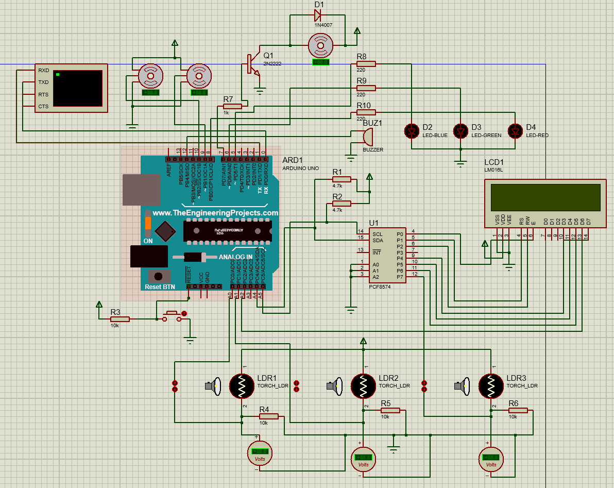
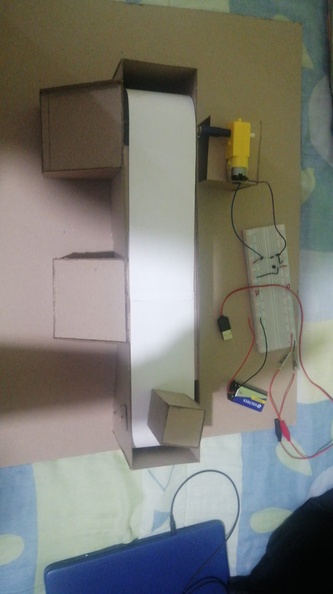
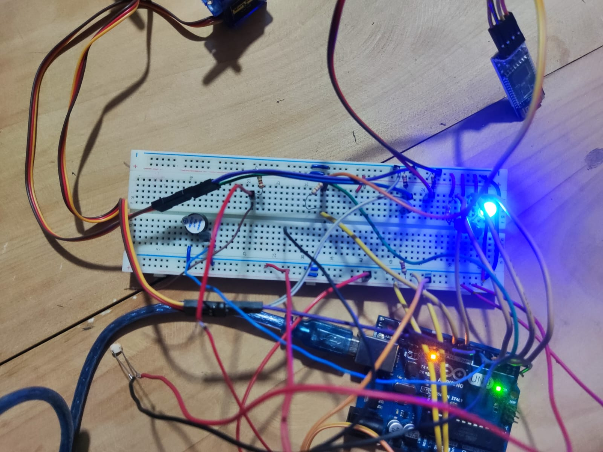
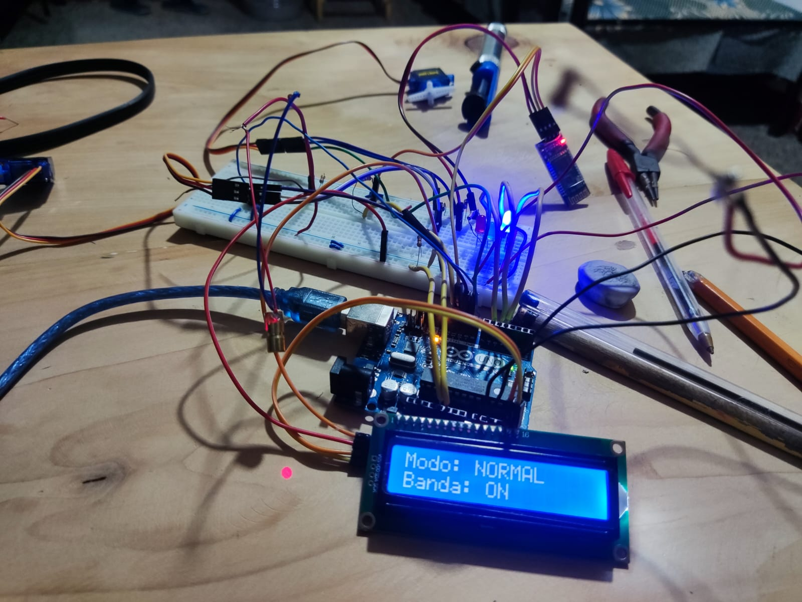
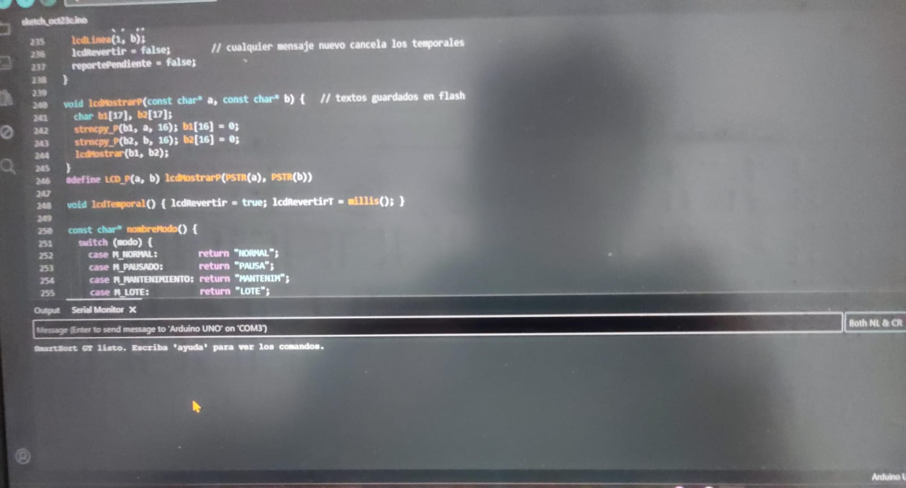

<div align="center">

**Universidad de San Carlos de Guatemala**  
**Facultad de Ingeniería**  
**Ingeniería en Ciencias y Sistemas**  
**Laboratorio Organización Computacional. Sección C.**  
**Segundo semestre 2026. Catedrático: Ing. Fernando José Paz**

<br><br><br>

# Proyecto #1
## SmartSort: Clasificadora de paquetes

<br><br><br>

**Grupo #2**

| Nombre | Carnet |
| :--- | :--- |
| Santiago Benjamin Tzoc Ican | 202504191 |
| Kevin Rolando Tujá Quiroa | 202431007 |
| Hugo Estuardo Rosal Del Cid | 8318054 |
| Juan Francisco Ramirez de Paz | 202205097 |

<br><br><br>

**Tutor:** Eduardo Antonio Reyes Pineda  
**Fecha de entrega:** Viernes 23 de octubre de 2026

</div>

## 1. Introducción

El presente documento detalla el diseño e implementación de "SmartSort GT", un prototipo funcional de clasificadora automática de paquetes desarrollado para el laboratorio de Organización Computacional Este sistema surge como propuesta de solución tecnológica para Cargo Rapido GT, una empresa logística guatemalteca que busca mitigar los errores de desvío y la falta de registros operativos derivados de su actual proceso de clasificación manual 

El prototipo consiste en una maqueta electromecánica controlada por un microcontrolador Arduino, el cual gestiona una banda transportadora y evalúa el tamaño de los paquetes mediante un portal de sensores láser configurado a dos alturas Dependiendo de la interrupción de los haces de luz, el sistema acciona servomotores para desviar cada paquete hacia su contenedor correspondiente (pequeño, grande o rechazo) Adicionalmente, el proyecto integra comunicación inalámbrica vía Bluetooth para su operación remota, una pantalla LCD I2C para monitoreo en tiempo real y el uso de memoria no volátil (EEPROM) para garantizar que las estadísticas de producción persistan ante cortes de energía o reinicios del sistema

## 2. Objetivos

### Objetivo General
Implementar un prototipo funcional de clasificadora automática de paquetes que determine categorías de tamaño mediante sensores láser, ejecute el desvío mecánico mediante servomotores y almacene estadísticas de operación en memoria EEPROM, siendo controlado de forma remota a través de Bluetooth

### Objetivos Específicos
* Construir una maqueta física que integre un motor DC para la banda transportadora, un portal de detección con fotorresistencias (LDR) y diodos láser, y mecanismos desviadores basados en servomotores
* Desarrollar el firmware del sistema utilizando la función `millis()` para la gestión del tiempo, garantizando la ejecución no bloqueante de la lectura de sensores, control de actuadores, y activación de LEDs y buzzer
* Gestionar el almacenamiento en la memoria EEPROM interna del Arduino para llevar un conteo persistente de los paquetes grandes, pequeños y rechazados del turno actual, así como el total histórico acumulado
* Habilitar el control remoto del sistema mediante un módulo Bluetooth HC-06, soportando comandos de operación y modos de lote, reflejando el estado del sistema en una pantalla LCD 16x2 en tiempo real

## 3. Diagrama esquemático del circuito

A continuación se presenta el diseño del circuito elaborado en Proteus, mostrando las conexiones del Arduino Uno con la pantalla LCD I2C, la simulación del módulo Bluetooth (terminal virtual en los pines RX/TX), los servomotores desviadores, el motor DC de la banda transportadora, el buzzer, los LEDs de estado y los divisores de tensión de las fotorresistencias (LDR) del portal de detección.



## 4. Código fuente comentado

El firmware completo del sistema se ubica en la ruta `SmartSort/SmartSort.ino` dentro del repositorio[cite: 14]. A continuación, se adjunta el código fuente:

```cpp
#include <Wire.h>
#include <LiquidCrystal_I2C.h>
#include <Servo.h>
#include <EEPROM.h>

const byte PIN_LDR_BAJO  = A0;
const byte PIN_LDR_ALTO  = A1;
const byte PIN_PRESENCIA = A2;
const byte PIN_LED_AZUL  = 5;
const byte PIN_LED_VERDE = 6;
const byte PIN_MOTOR     = 7;
const byte PIN_LED_ROJO  = 8;
const byte PIN_SERVO1    = 9;
const byte PIN_SERVO2    = 10;
const byte PIN_BUZZER    = 12;

const byte LCD_ADDR = 0x20;  // PCF8574 con A0-A2 a GND en Proteus; 0x27 en la mayoría de módulos reales

// Calibración: valor analógico por debajo del umbral = haz interrumpido
const int UMBRAL_BAJO      = 500;
const int UMBRAL_ALTO      = 500;
const int UMBRAL_PRESENCIA = 500;

const int ANG_NEUTRO = 0;
const int ANG_ACTIVO = 90;
const unsigned long T_VIAJE_S1     = 800;   // ms desde el portal hasta S1
const unsigned long T_VIAJE_S2     = 1200;  // ms desde el portal hasta S2
const unsigned long T_SERVO_ACTIVO = 600;
const unsigned long T_MIN_OBJETO   = 50;
const unsigned long T_REPORTE_LOTE = 2500;
const unsigned long T_ARRANQUE     = 300;

const bool DEBUG_SENSORES = false;

// En Proteus el ADC del modelo de Arduino no lee bien; true = leer los LDR como entradas digitales.
// En la maqueta real poner false para usar analogRead con los umbrales calibrados.
const bool MODO_SIMULACION = true;

// Tabla de direcciones EEPROM
const int DIR_FIRMA    = 0;  // 1 byte
const int DIR_GRANDES  = 1;  // uint16_t (1-2)
const int DIR_PEQUENOS = 3;  // uint16_t (3-4)
const int DIR_RECHAZOS = 5;  // uint16_t (5-6)
const int DIR_TOTAL    = 7;  // uint32_t (7-10)
const byte FIRMA = 0xA5;
const uint16_t MAX_TURNO = 65000;
const uint32_t MAX_TOTAL = 4000000000UL;

enum Modo { NORMAL, LOTE, MANTENIMIENTO };
enum Estado { LISTO, ACTIVO, PAUSADO, DETENIDO };
enum Categoria { NINGUNA, GRANDE, PEQUENO, RECHAZO };

LiquidCrystal_I2C lcd(LCD_ADDR, 16, 2);
Servo servo1, servo2;

Modo modo = NORMAL;
Estado estado = LISTO;
Categoria ultimo = NINGUNA;
bool bandaOn = false;
bool eepromFalla = false;

uint16_t loteObjetivo = 0;
uint16_t loteProcesados = 0;
bool loteFinalizando = false;
bool reporteDiferido = false;
unsigned long tReporte = 0;

bool objetoPresente = false;
bool vioBajo = false, vioAlto = false;
unsigned long tInicioObjeto = 0;

struct Pendiente { Categoria cat; unsigned long tDet; };
const byte MAX_COLA = 5;
Pendiente cola[MAX_COLA];
byte nCola = 0;
bool s1Activo = false, s2Activo = false;
unsigned long tS1 = 0, tS2 = 0;

byte patLed = 0, patRestantes = 0;
bool patEncendido = false;
unsigned long patOn = 0, patOff = 0, tPat = 0;

char bufSerial[24];
byte lenSerial = 0;

// ---------------- Salidas básicas ----------------

void mostrar(const char *l1, const char *l2) {
  lcd.clear();
  lcd.setCursor(0, 0);
  lcd.print(l1);
  lcd.setCursor(0, 1);
  lcd.print(l2);
}

void responder(const char *msg) {
  Serial.println(msg);
}

void encenderBanda(bool on) {
  bandaOn = on;
  digitalWrite(PIN_MOTOR, on ? HIGH : LOW);
}

const char *nombreCategoria(Categoria c) {
  switch (c) {
    case GRANDE:  return "GRANDE";
    case PEQUENO: return "PEQUENO";
    case RECHAZO: return "RECHAZO";
    default:      return "-";
  }
}

// ---------------- EEPROM ----------------

uint16_t leer16(int dir) { uint16_t v; EEPROM.get(dir, v); return v; }
uint32_t leer32(int dir) { uint32_t v; EEPROM.get(dir, v); return v; }

bool escribir16(int dir, uint16_t v) { EEPROM.put(dir, v); return leer16(dir) == v; }
bool escribir32(int dir, uint32_t v) { EEPROM.put(dir, v); return leer32(dir) == v; }

void marcarFallaEEPROM() {
  eepromFalla = true;
  digitalWrite(PIN_LED_ROJO, HIGH);
  mostrar("ERROR EEPROM", "Revisar memoria");
  responder("ERROR EEPROM");
}

void inicializarEEPROM() {
  if (EEPROM.read(DIR_FIRMA) != FIRMA) {
    bool ok = escribir16(DIR_GRANDES, 0) && escribir16(DIR_PEQUENOS, 0) &&
              escribir16(DIR_RECHAZOS, 0) && escribir32(DIR_TOTAL, 0);
    EEPROM.update(DIR_FIRMA, FIRMA);
    if (!ok || EEPROM.read(DIR_FIRMA) != FIRMA) { marcarFallaEEPROM(); return; }
  }
  if (leer16(DIR_GRANDES) > MAX_TURNO || leer16(DIR_PEQUENOS) > MAX_TURNO ||
      leer16(DIR_RECHAZOS) > MAX_TURNO || leer32(DIR_TOTAL) > MAX_TOTAL) {
    marcarFallaEEPROM();
  }
}

void registrarPaquete(Categoria c) {
  int dir = (c == GRANDE) ? DIR_GRANDES : (c == PEQUENO) ? DIR_PEQUENOS : DIR_RECHAZOS;
  uint16_t v = leer16(dir);
  uint32_t t = leer32(DIR_TOTAL);
  if (v >= MAX_TURNO || t >= MAX_TOTAL) { marcarFallaEEPROM(); return; }
  if (!escribir16(dir, v + 1) || !escribir32(DIR_TOTAL, t + 1)) marcarFallaEEPROM();
}

bool resetearTurno() {
  return escribir16(DIR_GRANDES, 0) && escribir16(DIR_PEQUENOS, 0) && escribir16(DIR_RECHAZOS, 0);
}

void mostrarReporte() {
  char l1[17], l2[17];
  snprintf(l1, sizeof(l1), "G:%u P:%u R:%u", leer16(DIR_GRANDES), leer16(DIR_PEQUENOS), leer16(DIR_RECHAZOS));
  snprintf(l2, sizeof(l2), "Total:%lu", (unsigned long)leer32(DIR_TOTAL));
  mostrar(l1, l2);
  responder(l1);
  responder(l2);
}

// ---------------- LEDs y buzzer (no bloqueante) ----------------

void salidasPatron(bool on) {
  digitalWrite(PIN_BUZZER, on ? HIGH : LOW);
  if (patLed == 0) return;
  bool mantenerRojo = (patLed == PIN_LED_ROJO && eepromFalla);
  digitalWrite(patLed, (on || mantenerRojo) ? HIGH : LOW);
}

void iniciarPatron(byte led, byte repeticiones, unsigned long tOn, unsigned long tOff) {
  salidasPatron(false);
  patLed = led;
  patRestantes = repeticiones;
  patOn = tOn;
  patOff = tOff;
  patEncendido = true;
  tPat = millis();
  salidasPatron(true);
}

void actualizarPatron() {
  if (patRestantes == 0) return;
  unsigned long ahora = millis();
  if (patEncendido && ahora - tPat >= patOn) {
    salidasPatron(false);
    patEncendido = false;
    tPat = ahora;
    patRestantes--;
  } else if (!patEncendido && ahora - tPat >= patOff) {
    salidasPatron(true);
    patEncendido = true;
    tPat = ahora;
  }
}

// ---------------- Servos ----------------

void programarDesvio(Categoria c) {
  if (c == RECHAZO || nCola >= MAX_COLA) return;
  cola[nCola].cat = c;
  cola[nCola].tDet = millis();
  nCola++;
}

void servosNeutros() {
  nCola = 0;
  servo1.write(ANG_NEUTRO);
  servo2.write(ANG_NEUTRO);
  s1Activo = s2Activo = false;
}

void actualizarServos() {
  unsigned long ahora = millis();
  for (byte i = 0; i < nCola; ) {
    unsigned long viaje = (cola[i].cat == GRANDE) ? T_VIAJE_S1 : T_VIAJE_S2;
    if (ahora - cola[i].tDet >= viaje) {
      if (cola[i].cat == GRANDE) { servo1.write(ANG_ACTIVO); s1Activo = true; tS1 = ahora; }
      else                       { servo2.write(ANG_ACTIVO); s2Activo = true; tS2 = ahora; }
      cola[i] = cola[--nCola];
    } else {
      i++;
    }
  }
  if (s1Activo && ahora - tS1 >= T_SERVO_ACTIVO) { servo1.write(ANG_NEUTRO); s1Activo = false; }
  if (s2Activo && ahora - tS2 >= T_SERVO_ACTIVO) { servo2.write(ANG_NEUTRO); s2Activo = false; }
}

// ---------------- Detección y clasificación ----------------

int leerSensor(byte pin) {
  if (MODO_SIMULACION) return digitalRead(pin) ? 1023 : 0;
  return analogRead(pin);
}

Categoria determinarCategoria(bool bajo, bool alto) {
  if (bajo && alto) return PEQUENO;  // lógica tal como la define el enunciado
  if (bajo)         return GRANDE;
  return RECHAZO;
}

void clasificarPaquete() {
  if (modo == MANTENIMIENTO || loteFinalizando) return;

  Categoria c = determinarCategoria(vioBajo, vioAlto);
  ultimo = c;
  registrarPaquete(c);
  programarDesvio(c);

  if (c == RECHAZO) iniciarPatron(PIN_LED_ROJO, 3, 100, 100);
  else              iniciarPatron(PIN_LED_VERDE, 1, 150, 0);

  char l1[17], l2[17] = "";
  snprintf(l1, sizeof(l1), "Paq: %s", nombreCategoria(c));
  if (modo == LOTE) {
    loteProcesados++;
    snprintf(l2, sizeof(l2), "Lote %u/%u", loteProcesados, loteObjetivo);
    if (loteProcesados >= loteObjetivo) loteFinalizando = true;
  }
  mostrar(l1, l2);
  responder(l1);
}

void leerSensores() {
  if (estado != ACTIVO && estado != PAUSADO) return;

  bool presencia = leerSensor(PIN_PRESENCIA) < UMBRAL_PRESENCIA;
  bool bajo = leerSensor(PIN_LDR_BAJO) < UMBRAL_BAJO;
  bool alto = leerSensor(PIN_LDR_ALTO) < UMBRAL_ALTO;

  bool algunoCortado = presencia || bajo || alto;

  if (algunoCortado && !objetoPresente) {
    objetoPresente = true;
    vioBajo = vioAlto = false;
    tInicioObjeto = millis();
  }
  if (!objetoPresente) return;

  vioBajo |= bajo;
  vioAlto |= alto;

  if (!algunoCortado) {
    objetoPresente = false;
    if (millis() - tInicioObjeto >= T_MIN_OBJETO) clasificarPaquete();
  }
}

void verificarFinLote() {
  if (!loteFinalizando || nCola > 0 || s1Activo || s2Activo || patRestantes > 0) return;
  loteFinalizando = false;
  encenderBanda(false);
  estado = DETENIDO;
  mostrar("Lote completo", "");
  responder("Lote completo");
  iniciarPatron(0, 1, 1500, 0);
  reporteDiferido = true;
  tReporte = millis();
}

void actualizarReporteDiferido() {
  if (reporteDiferido && millis() - tReporte >= T_REPORTE_LOTE) {
    reporteDiferido = false;
    mostrarReporte();
  }
}

void depurarSensores() {
  static unsigned long t = 0;
  if (!DEBUG_SENSORES || millis() - t < 500) return;
  t = millis();
  Serial.print("L1:");  Serial.print(leerSensor(PIN_LDR_BAJO));
  Serial.print(" L2:"); Serial.print(leerSensor(PIN_LDR_ALTO));
  Serial.print(" P:");  Serial.println(leerSensor(PIN_PRESENCIA));
}

// ---------------- Comandos ----------------

void mostrarModo() {
  const char *banda = bandaOn ? "Banda: ON" : "Banda: OFF";
  if (modo == LOTE) {
    char l1[17];
    if (loteObjetivo < 10) {
      snprintf(l1, sizeof(l1), "Lote: %u paquetes", loteObjetivo);
      mostrar(l1, banda);
    } else {
      snprintf(l1, sizeof(l1), "Lote: %u", loteObjetivo);
      mostrar(l1, "paquetes");
    }
    return;
  }
  mostrar(modo == NORMAL ? "Modo: NORMAL" : "Modo: MANTENIM.", banda);
}

void comandoInvalido() {
  mostrar("ERROR:", "Cmd invalido");
  responder("ERROR: Cmd invalido");
}

void cmdIniciar() {
  if (modo == LOTE && loteProcesados >= loteObjetivo) modo = NORMAL;
  estado = ACTIVO;
  encenderBanda(true);
  mostrarModo();
  responder("Banda iniciada");
}

void cmdPausa() {
  estado = PAUSADO;
  encenderBanda(false);
  mostrar("PAUSADO", "Banda: OFF");
  responder("Sistema pausado");
}

void cmdDetener() {
  loteFinalizando = false;
  estado = DETENIDO;
  encenderBanda(false);
  responder("Operacion finalizada");
  mostrarReporte();
}

void cmdResetear() {
  if (!resetearTurno()) { marcarFallaEEPROM(); return; }
  ultimo = NINGUNA;
  loteProcesados = 0;
  mostrar("Reset OK", "Nvo turno listo");
  responder("Reset OK - Nuevo turno listo");
}

void cmdLote(const char *arg) {
  byte n = strlen(arg);
  if (n == 0 || n > 3) { comandoInvalido(); return; }
  for (byte i = 0; i < n; i++) {
    if (!isdigit(arg[i])) { comandoInvalido(); return; }
  }
  int v = atoi(arg);
  if (v < 1) { comandoInvalido(); return; }

  modo = LOTE;
  loteObjetivo = v;
  loteProcesados = 0;
  loteFinalizando = false;
  estado = ACTIVO;
  encenderBanda(true);
  mostrarModo();
  responder("Modo lote activo");
}

void cmdModoNormal() {
  modo = NORMAL;
  loteFinalizando = false;
  estado = ACTIVO;
  encenderBanda(true);
  mostrarModo();
  responder("Modo normal");
}

void cmdMantenimiento() {
  modo = MANTENIMIENTO;
  loteFinalizando = false;
  servosNeutros();
  estado = ACTIVO;
  encenderBanda(true);
  mostrarModo();
  responder("Modo mantenimiento");
}

void cmdEstado() {
  const char *nm = (modo == NORMAL) ? "NORMAL" : (modo == LOTE) ? "LOTE" : "MANTEN";
  char l1[17], l2[17];
  snprintf(l1, sizeof(l1), "M:%s B:%s", nm, bandaOn ? "ON" : "OFF");
  snprintf(l2, sizeof(l2), "Ult: %s", nombreCategoria(ultimo));
  mostrar(l1, l2);
  responder(l1);
  responder(l2);
}

void cmdSensores() {
  char l[24];
  snprintf(l, sizeof(l), "L1:%d L2:%d P:%d", leerSensor(PIN_LDR_BAJO), leerSensor(PIN_LDR_ALTO), leerSensor(PIN_PRESENCIA));
  responder(l);
}

void ejecutarComando(const char *cmd) {
  reporteDiferido = false;
  if      (!strcmp(cmd, "iniciar"))                          cmdIniciar();
  else if (!strcmp(cmd, "pausa") || !strcmp(cmd, "pausar"))  cmdPausa();
  else if (!strcmp(cmd, "detener"))                          cmdDetener();
  else if (!strcmp(cmd, "reporte"))                          mostrarReporte();
  else if (!strcmp(cmd, "resetear"))                         cmdResetear();
  else if (!strncmp(cmd, "modo_lote:", 10))                  cmdLote(cmd + 10);
  else if (!strcmp(cmd, "modo_normal"))                      cmdModoNormal();
  else if (!strcmp(cmd, "modo_mantenimiento"))               cmdMantenimiento();
  else if (!strcmp(cmd, "estado"))                           cmdEstado();
  else if (!strcmp(cmd, "sensores"))                         cmdSensores();
  else {
    comandoInvalido();
    Serial.print("Recibido: [");
    Serial.print(cmd);
    Serial.println("]");
  }
}

bool caracterValido(char c) {
  return (c >= 'a' && c <= 'z') || (c >= 'A' && c <= 'Z') ||
         (c >= '0' && c <= '9') || c == '_' || c == ':' || c == '-';
}

void leerComandos(Stream &s, char *buf, byte &len) {
  while (s.available()) {
    char c = s.read();
    if (millis() < T_ARRANQUE) continue;  // descarta ruido de la línea serial al encender
    if (c == '\b' || c == 127) {  // borrar (backspace) desde el terminal
      if (len > 0) len--;
    } else if (c == '\n' || c == '\r') {
      if (len > 0) {
        buf[len] = '\0';
        ejecutarComando(buf);
        len = 0;
      }
    } else if (caracterValido(c) && len < 23) {
      buf[len++] = tolower(c);
    }
  }
}

// ---------------- Principal ----------------

void setup() {
  Serial.begin(9600);  // HC-06 en pines 0 (RX) y 1 (TX)

  pinMode(PIN_LED_AZUL, OUTPUT);
  pinMode(PIN_LED_VERDE, OUTPUT);
  pinMode(PIN_LED_ROJO, OUTPUT);
  pinMode(PIN_MOTOR, OUTPUT);
  pinMode(PIN_BUZZER, OUTPUT);
  encenderBanda(false);

  servo1.attach(PIN_SERVO1);
  servo2.attach(PIN_SERVO2);
  servosNeutros();

  lcd.init();
  lcd.backlight();

  inicializarEEPROM();
  digitalWrite(PIN_LED_AZUL, HIGH);

  if (!eepromFalla) {
    mostrar("SmartSort GT", "Esperando cmd...");
    responder("SmartSort GT listo");
  }
}

void loop() {
  leerComandos(Serial, bufSerial, lenSerial);
  leerSensores();
  actualizarServos();
  verificarFinLote();
  actualizarPatron();
  actualizarReporteDiferido();
  depurarSensores();
}

```
## 5. Tabla de direcciones EEPROM

| Dirección | Tamaño | Tipo | Contenido | Se borra con `resetear` |
|---|---|---|---|---|
| 0 | 1 byte | `byte` | Firma de inicialización (`0xA5`) | No |
| 1 – 2 | 2 bytes | `uint16_t` | Paquetes **GRANDES** del turno | Sí |
| 3 – 4 | 2 bytes | `uint16_t` | Paquetes **PEQUEÑOS** del turno | Sí |
| 5 – 6 | 2 bytes | `uint16_t` | Paquetes en **RECHAZO** del turno | Sí |
| 7 – 10 | 4 bytes | `uint32_t` | **Total histórico** de todos los turnos | **No** |

**Consideraciones implementadas:**
- **Firma:** al encender, si la dirección 0 no contiene `0xA5` (EEPROM nueva o con datos ajenos), se inicializan todos los contadores en cero y se escribe la firma.
- **Validación de rango:** antes de escribir se verifica que el contador no supere su máximo (`65000` por turno, `4 000 000 000` el total). Si se excede, se marca fallo de EEPROM.
- **Verificación de escritura:** después de cada escritura se vuelve a leer el valor. Si no coincide, se marca fallo de EEPROM (LED rojo encendido permanente y mensaje en LCD).
- **Escritura inmediata:** cada paquete clasificado actualiza su contador y el total en el mismo momento.
- **Sin variables globales de persistencia:** los contadores se leen y escriben directamente en EEPROM; no se guardan copias en RAM.
- Se usa `EEPROM.put()`, que solo reescribe los bytes que cambian, para reducir el desgaste de la memoria.

<br>

## 6. Explicación del sistema de detección láser y calibración

### Funcionamiento
Cada sensor es un par diodo láser + LDR. Mientras el haz llega al LDR, su resistencia es baja y el voltaje en el pin analógico es alto. Cuando un paquete interrumpe el haz, la resistencia sube y el voltaje cae. El Arduino compara la lectura con un umbral:

```
lectura < UMBRAL  →  haz interrumpido
lectura ≥ UMBRAL  →  haz libre
```

### Calibración en simulación (Proteus)

| Estado | Voltaje medido | Lectura ADC equivalente |
|---|---|---|
| Haz libre (luz máxima) | 4.76 V | ≈ 974 |
| Haz cortado (luz mínima) | 0.04 V | ≈ 8 |
| **Umbral elegido** | ≈ 2.44 V | **500** |

El umbral se colocó a la mitad del rango para tener el mismo margen hacia ambos lados.


### Calibración en la maqueta física

Valores medidos con el comando `sensores` (completar con los valores reales):

| Sensor | Lectura con haz libre | Lectura con haz cortado | Umbral usado |
|---|---|---|---|
| L1 — bajo (A0) | | | |
| L2 — alto (A1) | | | |
| Presencia (A2) | | | |

| Parámetro de sincronización | Valor | Descripción |
|---|---|---|
| `T_VIAJE_S1` | 800 ms | Tiempo del portal al servo S1 |
| `T_VIAJE_S2` | 1200 ms | Tiempo del portal al servo S2 |
| `T_SERVO_ACTIVO` | 600 ms | Tiempo que el servo permanece en posición activa |
| `ANG_NEUTRO` / `ANG_ACTIVO` | 0° / 90° | Posiciones de los desviadores |
<br>

## 7. Presupuesto estimado de componentes

A continuación se detalla el costo de los componentes electrónicos indicados en la planificación, junto con una estimación realista de los insumos mecánicos, consumibles y materiales estructurales utilizados para el ensamblaje del circuito y la construcción de la maqueta física:

| No. | Componente | Cantidad | Precio c/u. (Q) | Subtotal (Q) |
| :--- | :--- | :---: | :---: | :---: |
| 1 | Módulo Bluetooth HC-06/05 | 1 | 60.00 | 60.00 |
| 2 | LCD 16x2 con I2C | 1 | 50.00 | 50.00 |
| 3 | Diodo láser | 2 | 13.00 | 26.00 |
| 4 | LDR (fotorresistencia) | 3 | 3.00 | 9.00 |
| 5 | Servomotor | 2 | 28.00 | 56.00 |
| 6 | Arduino Uno con cable USB | 1 | 85.00 | 85.00 |
| 7 | Motor DC con caja reductora | 1 | 35.00 | 35.00 |
| 8 | Fuente de alimentación (Adaptador 5V/9V o portabaterías) | 1 | 45.00 | 45.00 |
| 9 | Poleas y faja/banda elástica para el transportador | 1 | 35.00 | 35.00 |
| 10 | Protoboard y set de cables jumper macho/hembra | 1 | 45.00 | 45.00 |
| 11 | Componentes pasivos (Resistencias, Transistor 2N2222, Diodo) | 1 | 15.00 | 15.00 |
| 12 | Consumibles (Estaño, cinta de aislar, termocontráctil) | 1 | 20.00 | 20.00 |
| 13 | Buzzer activo | 1 | 5.00 | 5.00 |
| 14 | LEDs (Azul, Verde, Rojo) | 3 | 1.00 | 3.00 |
| 15 | Materiales de maqueta (madera, acrílico, pintura, silicón) | 1 | 55.00 | 55.00 |
| | **Total Estimado** | | | **Q 544.00** |

## 8. Galería fotográfica

A continuación se presentan las evidencias de la construcción e implementación física del proyecto:

### Maqueta terminada


### Circuito en Protoboard


### Conexiones del Microcontrolador


### Desarrollo del Firmware

## 9. Conclusiones técnicas y aprendizajes

* **Gestión no bloqueante del microcontrolador:** La sustitución de retardos tradicionales (`delay()`) por el uso de la función `millis()` fue indispensable para mantener un sistema multitarea. Esto garantizó que la lectura continua de los sensores láser y la recepción de comandos por Bluetooth no se interrumpieran mientras los servomotores ejecutaban los desvíos.
* **Persistencia y validación en EEPROM:** Se comprobó que almacenar las estadísticas en la memoria no volátil asegura la integridad de los datos ante cortes de energía. La implementación de una firma de arranque (`0xA5`) y la validación de rangos antes de cada escritura demostraron ser prácticas vitales para evitar la corrupción de memoria.
* **Calibración analógica en entornos físicos:** El despliegue de los sensores LDR evidenció que la luz ambiental y la velocidad de la banda transportadora introducen variaciones analógicas significativas. Fue necesario establecer un umbral intermedio experimental de `500` y tiempos de tolerancia lógicos (`T_MIN_OBJETO`) para mitigar falsos positivos.
* **Sincronización electromecánica:** La integración del firmware con la maqueta física requirió un ajuste preciso de los tiempos de viaje de los paquetes (`T_VIAJE_S1`, `T_VIAJE_S2`). Se concluye que en los sistemas embebidos de clasificación, la lógica de software depende críticamente de la caracterización mecánica del hardware para ejecutar desvíos en el momento exacto.

## Anexo
### Mapa de pines del sistema (Hardware)
Para facilitar futuras conexiones y el mantenimiento de la maqueta, se documenta la asignación exacta de pines utilizada en el Arduino Uno:

| Pin Arduino | Componente conectado | Tipo |
| :--- | :--- | :--- |
| `A0` | LDR Láser Bajo (L1) | Entrada Analógica |
| `A1` | LDR Láser Alto (L2) | Entrada Analógica |
| `A2` | LDR Sensor de Presencia | Entrada Analógica |
| `5` | LED Azul (Sistema listo) | Salida Digital |
| `6` | LED Verde (Paquete aceptado) | Salida Digital |
| `7` | Motor DC (Banda transportadora) | Salida Digital |
| `8` | LED Rojo (Rechazo / Error EEPROM) | Salida Digital |
| `9` | Servomotor 1 (Desvío paquete grande) | Salida PWM |
| `10` | Servomotor 2 (Desvío paquete pequeño) | Salida PWM |
| `12` | Buzzer activo (Alertas sonoras) | Salida Digital |
| `A4 (SDA) / A5 (SCL)` | Pantalla LCD 16x2 (Módulo I2C) | Comunicación |
| `0 (RX) / 1 (TX)` | Módulo Bluetooth HC-06 | Comunicación Serial |